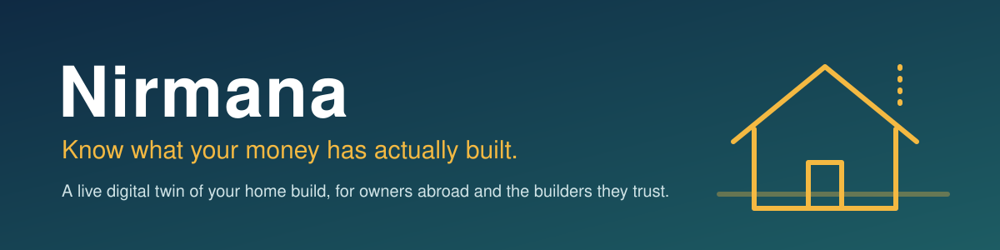

<p align="center">
  
</p>

<p align="center">
  <a href="https://github.com/SachinthaWijesundara/Nirmana_V2/actions/workflows/ci.yml"></a>
  
  
</p>

**Nirmana** (working name *GedaraTwin*) helps people who are building a home in Sri Lanka while living abroad. It keeps a living model of the house, reads the builder's everyday messages, and protects both sides: the owner from paying for work that isn't there, and the builder from unfair blame for delays.

It is a website where the **client** (the home owner), the **contractor** (the builder) and the **architect** each have their own account and work on the same project, every action written to a record nobody can edit.

---

## The problem

Imagine Nimal, working in Qatar, building a house in Kurunegala. His builder says the slab is done and asks for another Rs. 800,000. Nimal can't visit. He has WhatsApp messages and a feeling something is off.

- **Owners abroad** can't tell if the money they've sent matches the work on site.
- **Builders** get blamed for delays caused by rain, late materials or an earlier stage, with nothing on record to show it.

## What Nirmana does

| Helper | What it does for you |
|---|---|
| **Intake** | Reads the builder's message as they'd naturally write it, in **English, Sinhala, Tamil or Singlish**, such as *"slab eka iwarai, cement 40k gaththa"*. It works out which part of the house it's about and records progress, materials and money spent. |
| **Payment Guard** | Compares **money paid** with **work actually verified**. If a payment request runs ahead of the proven work, it holds the payment. When proof arrives, it releases the part that's now covered. |
| **Photo proof** | The builder (or architect) sends a photo of the finished work. AI looks at it and decides whether it really shows that part of the house and how complete it is. A clear match counts as proof, and Payment Guard releases the money it covers. A wrong or unfinished photo is turned down, with the reason. |
| **Delay Detector** | Spots parts of the build that are behind schedule and traces the delay back to its real cause (for example, Walls are late because the Slab was late). It writes a dated notice with the evidence, a fair record for the builder. |
| **Forecaster** | Works out when the house will really be finished at the current pace, which stages hold everything else up, and what it will cost to complete. |
| **What if?** | Answers questions like *"what if cement goes up 15%?"* or *"what if the roof is delayed three weeks?"* without changing the real record. |
| **Ask the house** | Answers plain questions such as *"How much have we spent on cement?"* or *"Why is a payment held?"* from the project's actual records, in **English, Sinhala or Tamil**. |

### A worked example

> Nimal has paid **Rs. 4.20M**. The work verified as built is worth **Rs. 2.60M**.
> The builder asks for **Rs. 800k** more.
> Payment Guard: **hold.** Paid is already ahead of verified work.
> The builder sends a photo of the finished slab. The AI confirms it shows a completed slab, so the slab counts as verified. Part of the request is now covered, so that part is released and the rest stays held.

Money decisions are made by clear, fixed rules, never by the AI's opinion. The AI is only used to understand messages, check photos and put answers into words; the numbers always come from the project's records.

## Who is it for?

- **Home owners abroad** who want to know where their money went.
- **Builders and site supervisors** who want a clear, timestamped record of progress and of what caused a delay.
- **Architects** who verify the work and sign off progress.

## The website

Everyone signs up with their email, a password and their role. What you can do on a project depends on your role there; the website only shows the actions your role allows, and the server checks the role again.

| Role | What they do on a project |
|---|---|
| **Client** | Creates the project, invites the contractor and architect by email, sets the budget and plan, records payments already made, asks questions, follows progress and money. |
| **Contractor** | Sends site updates in their own words, reports progress, asks for payments, sends photo proof. |
| **Architect** | Helps plan the build, verifies progress from proof (which releases held money), can send photo proof too. |

Each project page has these tabs:

| Tab | What you see or do |
|---|---|
| **Overview** | Paid, verified built, held and budget at a glance; every part of the house with its reported and verified progress, cost and status; all payments. |
| **Plan** | Add parts of the house with cost, dates and what must finish first; record past payments. |
| **Actions** | Site updates, progress reports and payment requests (contractor); verification (architect); the Delay Detector and its notices. |
| **Photo** | Send a photo as proof and see what the AI found. |
| **Forecast** | Finish date, days late, critical path, cost to complete, and the "what if" calculator. |
| **Ask** | Ask about the house and choose the answer language. |
| **Team** | Who is on the project and in which role; invite new people. |
| **Activity** | The full record of who did what, in which role and when. It cannot be edited. |

The website has a dark, minimal look and works on phones as well as laptops. Each person only sees the projects they belong to. Nothing in the app is pre-filled: projects, plans, payments and progress are all entered through the website (or the API) and stored in the project's database.

## Current status

This is a hackathon prototype (AI Hackathon 2026, Jaseci). It runs on **Jac 0.34.23**. The accounts, the website and all seven helpers above work and are tested, including with a real AI model, and a full run with a client, a contractor and an architect working on the same project passes on a real Jac 0.34 server: every action by every role shows up for the others. Not built yet: live material prices, payment milestones with architect sign-off, receipts and the ledger, change orders, plan drawings, messages, and the estimator from the full design. See [`BACKEND.md`](BACKEND.md) for the technical details, and [`plan.md`](plan.md) and [`PLAN-P2.md`](PLAN-P2.md) for the original plans.

## Try it

You'll need **Jac 0.34.23** (Linux, macOS, or WSL on Windows), which brings its own Python, AI library and web client.

```bash
# 1. Get the code
git clone https://github.com/SachinthaWijesundara/Nirmana_V2.git
cd Nirmana_V2

# 2. Install Jac 0.34.23 (Linux or macOS; on Windows use WSL)
curl -fsSL https://raw.githubusercontent.com/jaseci-labs/jaseci/main/scripts/install.sh | bash
jac install

# 3. Start the website (the first start installs and builds it, which takes a minute)
jac start main.jac
```

Open **http://localhost:8000** and sign up. To fill it with the demo project, run this in a second terminal while the website is running:

```bash
jac run scripts/seed_demo.jac
```

### Demo accounts

After loading the demo data you can log in as:

| Role | Email | Password | Projects |
|---|---|---|---|
| Client | nimali.perera@nirmana.demo | Client@2026 | Perera House |
| Contractor | ruwan.silva@nirmana.demo | Contractor@2026 | Perera House, Jayasuriya Annex |
| Architect | anushka.fernando@nirmana.demo | Architect@2026 | Perera House |
| Client | kamal.jayasuriya@nirmana.demo | Client2@2026 | Jayasuriya Annex |

These are made-up accounts for testing only.

### Turning on the AI

The AI parts (reading messages, checking photos, answering questions) run on **Groq**. Get a key from Groq and set it as an environment variable before starting the website:

```bash
export GROQ_API_KEY=your-key-here     # Windows PowerShell: $env:GROQ_API_KEY = "your-key-here"
jac start main.jac
```

On JacHammer, add `GROQ_API_KEY` under **Settings → Environment** instead. **Never paste a key into a file or commit it**; the project's checks will reject it. Without a key, Nirmana still works: messages and questions are handled by simpler built-in rules, and photos are kept for the architect to review by hand.

### Running it on JacHammer

Open the project in JacHammer, add `GROQ_API_KEY` under **Settings → Environment**, and start the preview. A new preview starts with an empty database: sign up there, or load the demo accounts by pointing the demo script at the preview's address:

```bash
NIRMANA_URL=https://your-preview-address jac run scripts/seed_demo.jac
```

### Things to know about Jac 0.34

- The website's client keeps the answers of server calls for a minute. Nirmana clears that store before every page load and every action, so what you see is always current.
- Numbers typed into forms reach the server as text, and a value the caller leaves out arrives as text too. The server turns them back into numbers before using them.
- The web client needs the `@tanstack/react-form` package, which is listed in `jac.toml`.

### Running the checks

```bash
export GEDARA_LLM=mock              # Windows PowerShell: $env:GEDARA_LLM = "mock"
jac test tests/api_tests.jac
jac test tests/intake_tests.jac
jac test tests/payment_tests.jac
jac test tests/delay_tests.jac
jac test tests/forecast_tests.jac
```

`GEDARA_LLM=mock` uses a built-in practice AI, so no account or key is needed. If everything is working you'll see `Passed successfully.` after each one.

## How the pieces fit

```
Client / Contractor / Architect ──► Website ──► sign-in and role check
                                                   │
Builder's message ──► Intake ──────────────► House model ◄── Payment Guard ──► hold / release
Site photo ─────────► Photo proof ─ verified ─────┤                ▲
                                                   ├── Delay Detector ──► dated delay notice
                                                   ├── Forecaster / What if ──► finish date, cost
                                                   └── Ask the house ──► answer from the records
```

| Folder / file | Contents |
|---|---|
| `ui/` | The website, written in Jac: sign-in and projects (`App.cl.jac`), the project page (`ProjectView.cl.jac`) and its styles |
| `api/` | Accounts and role checks (`access.jac`), and everything the website calls (`projects.jac`) |
| `agents/` | The helpers: `intake.jac`, `payment.jac`, `photo.jac`, `delay.jac`, `forecast.jac`, `scenario.jac`, `qa.jac` |
| `twin.jac` | The house model: projects, people, parts of the house, payments, updates and the activity record |
| `main.jac` | Starts the website and the API together |
| `seed/`, `scripts/` | The demo data and the script that loads it through the website's own API |
| `tests/` | Tests for each helper and for the API |
| `.github/` | Automatic checks that run on every change |

## Quality checks

Every change is automatically checked for:

1. **No leaked keys**: no AI keys committed to the repo.
2. **Jac share**: at least 80% of the code is written in Jac (a hackathon rule). The whole project, website included, is about 98% Jac.
3. **Code correctness**: every file is type-checked and every test must pass.

## Built with

[Jac / Jaseci](https://docs.jaseci.org), including its graph-based programming model, built-in AI functions (byLLM), built-in accounts and Jac's web client for the website, with AI models on Groq for reading messages, checking photos and answering questions.

## Team

Built for the AI Hackathon 2026 (Jaseci, Moratuwa) by the Nirmana team.
